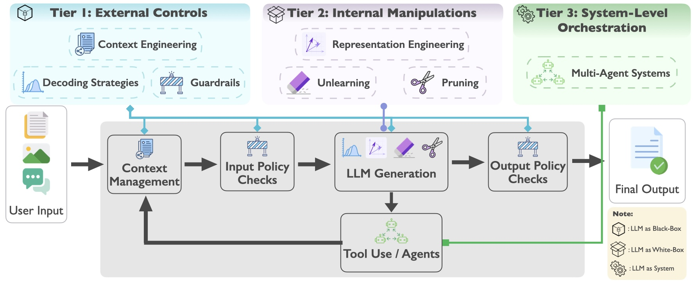

<div align="center">

# Inference-Time Control for Trustworthy Large Language Models

[](https://github.com/sindresorhus/awesome)
[![Paper](https://img.shields.io/badge/Paper-A42C25?style=for-the-badge&logoColor=white&logo=data:image/png;base64,iVBORw0KGgoAAAANSUhEUgAAADAAAAAwCAYAAABXAvmHAAAIsklEQVR42s2aa4xdVRXHf2vtc+bemXamU1osD3lpQAQEyqMBedhGxaCgGJzC0DZoop+MflA0+oVhTEhEQyJqgsHE4CvBMQQfRGL80GI0GuIHEi1qBBHKw9rOzJ3XfZyz915+OPfemXbudO5Mh0lPsnPu5J67z/nv/1r/9V/7DJzkYSCsw2H7ScwW32tNbm5/7n07/UlvYxpKa/nUJcBcJldXXmnfyxAR7KQBtCaylz6/LU6M/UPd9CBe15YPgeDJUF5A5aduZua7sou6jaAySgRIVj35gfc5eNYHqX7UDehgmLAgiptfm7U5nNJDiSspcWWUjUP2nP+E7Kgfai2grnrmnc8GUMTne8nnDNG3JPZDxEKNGCYt1z7ZEUmetr9v6W9Fga4ufEZUBLPxZy7D1a6Ps1VE1L0VAEQQEVSUNFQs10G5PE7XvyiCcQC3umU7gALE7MXdWq6mZj6sixgpjqpFM/bay5RlFz5ZXfKOevvbSE/0s3dRPVxEKkaMYLbyRJVipRFZ9lK1BojI+by26SyY+vcqknhMYXdgsHyzluWiePhwFEkUg6QXSFfIhAHBIIfgIURQBZWlL1fFYTE5ORUSvYekhsWZiKlqDzz3fOBfrxpOIVpX8c3WQeFtm4VzzxA2nya4kkDdyOsFkCVZSQu9S1YePruDvfCVLZjczvQRCDUXLcH1wqNPeh7/db7y0FbYdppw8fnKre9NuPuWhHMuUOKsYXbi0FpZEh8YcQBhQ+l2NvVtjbWjQQiCCBj0lYpsKKXF2SkkDtIEkuS4syuGU4gR3jxq7P9L4MvfbnDFcJXRRxpEBU1OnFfJCtUnFtTrHgzD/68ZlQIY0YoYFinO3R6JazOMCEzOGA88lvH8PyNPfKNcaGXszESyMu0fjXboaxdGpzcxVwdfWVb7+/uEgQ3H5oQAmYdaA+Zqhg/zOWHNB00c/OJZz30PN/jO/WX8jJ0cgKb2xyBylxvoK8VK1RMqCeI6cpw48AG+sCflvk/3UJuy9kqLQD2DuRqMT0cOvmz8/HeeZ/7o20z4AM7Bo0/mfOaOlMsvUfIaiyqXdqvV7BwNZiOJGHfTMAhVxU+xFIDW0VeGjYPClk3C5uYYHBDOOF145/nCju0JnxpK+c33e3l8pIxzTSaaPj0EePxpDyXB4iqT2H425kQw3ui9TkrJpdRDJEwpVl92ihDBPOS+qfOtkYNvgJ8zsikjqxj37k355G0pZsXqt9blT38NxDnDudWq0FBxiub3Sm9KFBclTEJsLDvFwip7/FApJLQVWrEGw7cUUW1xPm9efj0yO3MsqK5zwMxERIJNjgzGWe5gLoPY48iPrq3NEdBonLlVSJOCMS3UmVoGIXYuCMszcOCBYn3mkg/pQHlbyEIUQcyPs6YGTlpABG35iC6mXx7AzkL7Y2QfYCJiWEaRwNqsA2vQlkaIKhyejDQyQxdMXUo55u+uQ6it/W9+8wIs32WzDUGcEmchNBVoGQDWlMXW6GBPiFZU47QPntrv2yFlzQnO3aZs7BNih2KWdKX9ef1Ot3lDn1WqXtQlhBmIc10R6BSkaR8WtTzaHIlACr98Kuexp3y7krc0f/vFgusXssp8LekOQKH9Gg/pMJkHTBCFfLzQRikty0C1DlOVQirblqGpTHNVGJ8yXnwt8qvfe37yjC9WucVcc459t6awRMu0JAAbG3Miu4MdKu2gpNtjNTMBB4r5cbDQ5LMzgJY9eOiHGd96Iu94mQ9GvXGsb2rN2JNClsOduxJuvj4hzBmdmtalGTj9YAFY7B7d0CMxDx5IMA9+ousSUs+gntnyYSbzZi5a8fDXvFv53v0lQmZFI9MtA+228fDIxtiwj2s1A0OLFQ8QJrpWIKfzBUiWSPAYF7vXe29LeeRLJTb1FxVbdUV2ekzNdkfeSD+o/eVz4kwjipqCg1AFP901AyF2Z63TBN51nnLTdse+jyRcf00CDTvhw58AwEETwcIh2adOQImAIq6Qz1hdVkK1GQrvv9Zx4w5HqM/3ua1w2dgnbNkEZ5+uvONs4bwzlZ5BAQ9+trDPusw6LQJgI03tP/LQWWT+AzbbADOHWBE2vgLWACmfGIBCDPCxmx2fu68ME7b4brHV1APesBzyShFr3W74JB0qrzJKDJm/0w309lulGkTEtTov80fms62LHJipQn7EyDtoOAsYkeb2ilvh9thinDsfCGYmEmwPeQfx9RMrbthbvfCisaAv1i72hZYFUFgHMV5/8ApSdy3VzMTEtS+NjSKEurAQ63Ucx8ClLU84rP0ljUYoGLB5AGGyCYBTC0B7z+fVh3ujxSFqOcgCgKKFAoVa82enHANjaiBIY5du6Lkg1n2U9vdWODI/WSjQ+rxVWimAgyZgUeIeEtfZ/LY80CkEIFlgHaL998FtBD7MXCYsendgmD+64s289WGgtWWYcwf95cHoQxBZuMxS2GdfOaH+tyrnwiGyDgy0twyxYcLxzbPR9kBhqvi8RE/byApjli3wPln+FkScFMYGIDEbciKjwV75+qXR2Q1UG03fv/AHjqKNnOnoQlXBasZnh1Juuc6RNn+dB7jiQsWqttp3QR1ZjoFco2YFAwcuEYCoYVgHepNYqXlZZDG0qMCWg/QsAiBSfHXVe5SrrnLzXwvQMGK2NqFkRtQyxJq9RP/UG2ZI0mwbezhkQ9R90/cf59qliy5MwNfBqovZWbM8MAK9klLjR3IZme0nSUSw/D/JjUl/z0WxmkeRDjJjEfLJrjanWMMibdZcKSFimDtN0jAZ/+CSgUdsZFbZSSjeM6W6h1ICtTwu1kkt/K4fX9N9oC6NoIgDesSRALP2W9ebDMvlb1ZbL7qTmZe+ui1Gu11rOSqSLFYMBasjVin2RdaxhoWIF88EZi9oJj+Qq2d/PF+3mu/INqZbp2HuBuqNJaYpAbPQyBe0D+uAogTOa47GGblmZvxYz3aKGLEV5IKY4Tr9a8//AT07LxA6pwz7AAAAAElFTkSuQmCC)](https://www.preprints.org/manuscript/202605.1041)
[](https://leopoldwhite.github.io/Awesome-Inference-Time-Trustworthiness/)

</div>

> We welcome everyone to open an issue for any related work we haven't covered, and we'll try to address it in the next release!

## 🎉 News

- **[2026-05]** 🔥 Paper available on preprints.org: [https://www.preprints.org/manuscript/202605.1041](https://www.preprints.org/manuscript/202605.1041)

## 🎈 Citation

If you find this work helpful, please cite us:

```bibtex
@article{bai2026inferencetime,
  title     = {Inference-Time Control for Trustworthy Large Language Models},
  author    = {Bai, Yuyang and Liu, Zheyuan and Yan, Han and Xu, Zhangchen and Wan, Yixin and Chen, Canyu and Wang, Zehong and Yuan, Xiangchi and Huang, Yue and Dou, Guangyao and Zhang, Yuji and Zhu, Hangxiao and Li, Zhuofeng and Li, Manling and Zhang, Xiangliang and Bansal, Mohit and Koyejo, Sanmi and Chang, Kai-Wei and Zhang, Yu and Jiang, Meng},
  journal   = {Preprints},
  year      = {2026},
  month     = {May},
  publisher = {Preprints},
  doi       = {10.20944/preprints202605.1041.v1},
  url       = {https://doi.org/10.20944/preprints202605.1041.v1}
}
```

## 📖 Contents

- [Inference-Time Control for Trustworthy Large Language Models](#inference-time-control-for-trustworthy-large-language-models)
  - [🎉 News](#-news)
  - [🎈 Citation](#-citation)
  - [📖 Contents](#-contents)
  - [🗺️ Overview](#️-overview)
  - [📄 Paper List](#-paper-list)
    - [Tier 1: External Controls](#tier-1-external-controls)
      - [Context Engineering](#context-engineering)
      - [Guardrails](#guardrails)
      - [Decoding Strategies](#decoding-strategies)
    - [Tier 2: Internal Manipulations](#tier-2-internal-manipulations)
      - [Representation Engineering](#representation-engineering)
      - [Unlearning](#unlearning)
      - [Pruning](#pruning)
    - [Tier 3: System-Level Orchestration](#tier-3-system-level-orchestration)
      - [Multi-Agent Systems](#multi-agent-systems)
    - [Evaluation](#evaluation)

## 🗺️ Overview

This work covers **Inference-Time Control** methods for building trustworthy LLMs, organized into three tiers:

1. **Tier 1 — External Controls**: Treat the model as a black box. Shape behavior by modifying inputs, decoding process, or outputs, without changing internal weights or activations.
   - *Context Engineering*: Strategic prompt design through rules, instructions, or few-shot exemplars.
   - *Guardrails*: External modules that inspect inputs/outputs against safety or policy constraints.
   - *Decoding Strategies*: Manipulation of token-level distributions during generation.

2. **Tier 2 — Internal Manipulations**: Require white-box access. Intervene directly in the model's internal computation.
   - *Representation Engineering*: Direct modification of internal activations via steering vectors.
   - *Unlearning*: Targeted removal of information, behaviors, or biases from a pre-trained model.
   - *Pruning*: Post-training removal of weights, neurons, or attention heads for trust-related effects.

3. **Tier 3 — System-Level Orchestration**: Coordinate multiple LLM agents through structured interaction patterns.
   - *Multi-Agent Systems*: Coordinated agent interactions such as debate or cross-verification.

<p align="center">
  
</p>

## 📄 Paper List

### Tier 1: External Controls

#### Context Engineering

| Year | Title | Paper | Github |
|:----:|:------|:-----:|:-----:|
| 2023.10 | Self-RAG: Learning to Retrieve, Generate, and Critique through Self-Reflection | [](https://arxiv.org/abs/2310.11511) | [](https://github.com/AkariAsai/self-rag) |
| 2023.09 | Defending Against Alignment-Breaking Attacks via Robustly Aligned LLM | [](https://arxiv.org/abs/2309.14348) | [](https://github.com/AAAAAAsuka/llm_defends) |
| 2024.05 | Phantom: General Trigger Attacks on Retrieval Augmented Language Generation | [](https://arxiv.org/abs/2405.20485) | - |
| 2024.12 | Improving Factuality with Explicit Working Memory | [](https://arxiv.org/abs/2412.18069) | - |
| 2024.11 | SPICA: Retrieving Scenarios for Pluralistic In-Context Alignment | [](https://arxiv.org/abs/2411.10912) | [](https://github.com/Social-Futures-Lab/SPICA-code) |
| 2023.07 | Queer People Are People First: Deconstructing Sexual Identity Stereotypes in Large Language Models | [](https://arxiv.org/abs/2307.00101) | - |
| 2023.09 | Chain-of-Verification Reduces Hallucination in Large Language Models | [](https://arxiv.org/abs/2309.11495) | [](https://github.com/ritun16/chain-of-verification) |
| 2023.12 | Breaking the Bias: Gender Fairness in LLMs Using Prompt Engineering and In-Context Learning | [](https://doi.org/10.21659/rupkatha.v15n4.10) | - |
| 2025.02 | FACTER: Fairness-Aware Conformal Thresholding and Prompt Engineering for Enabling Fair LLM-Based Recommender Systems | [](https://arxiv.org/abs/2502.02966) | [](https://github.com/AryaFayyazi/FACTER) |
| 2024.06 | Teaching LLMs to Abstain across Languages via Multilingual Feedback | [](https://arxiv.org/abs/2406.15948) | [](https://github.com/BunsenFeng/M-AbstainQA) |
| 2023.05 | Why So Gullible? Enhancing the Robustness of Retrieval-Augmented Models against Counterfactual Noise | [](https://arxiv.org/abs/2305.01579) | [](https://github.com/wjdghks950/discern-and-answer) |
| 2023.09 | Bias Testing and Mitigation in LLM-Based Code Generation | [](https://arxiv.org/abs/2309.14345) | [](https://github.com/huangd1999/CBS) |
| 2024.02 | Defending Large Language Models Against Jailbreak Attacks via Semantic Smoothing | [](https://arxiv.org/abs/2402.16192) | [](https://github.com/UCSB-NLP-Chang/SemanticSmooth) |
| 2024.04 | Prompting Techniques for Reducing Social Bias in LLMs through System 1 and System 2 Cognitive Processes | [](https://arxiv.org/abs/2404.17218) | [](https://github.com/kamruzzaman15/Reduce-Social-Bias-in-LLMs) |
| 2023.09 | Certifying LLM Safety against Adversarial Prompting | [](https://arxiv.org/abs/2309.02705) | [](https://github.com/aounon/certified-llm-safety) |
| 2024.03 | Think Twice Before Trusting: Self-Detection for Large Language Models through Comprehensive Answer Reflection | [](https://arxiv.org/abs/2403.09972) | - |
| 2024.10 | SafetyAnalyst: Interpretable, Transparent, and Steerable Safety Moderation for AI Behavior | [](https://arxiv.org/abs/2410.16665) | [](https://github.com/jl3676/SafetyAnalyst) |
| 2022.10 | Measuring and Narrowing the Compositionality Gap in Language Models | [](https://arxiv.org/abs/2210.03350) | [](https://github.com/ofirpress/self-ask) |
| 2025.06 | Saffron-1: Towards an Inference Scaling Paradigm for LLM Safety Assurance | [](https://arxiv.org/abs/2506.06444) | [](https://github.com/q-rz/saffron) |
| 2023.01 | REPLUG: Retrieval-Augmented Black-Box Language Models | [](https://arxiv.org/abs/2301.12652) | [](https://github.com/intellabs/fastrag) |
| 2024.03 | FairRAG: Fair Human Generation via Fair Retrieval Augmentation | [](https://arxiv.org/abs/2403.19964) | - |
| 2023.10 | InferDPT: Privacy-Preserving Inference for Black-Box Large Language Models | [](https://arxiv.org/abs/2310.12214) | [](https://github.com/mengtong0110/InferDPT) |
| 2024.02 | DELL: Generating Reactions and Explanations for LLM-Based Misinformation Detection | [](https://arxiv.org/abs/2402.10426) | [](https://github.com/whr000001/dell) |
| 2023.06 | Augmenting Language Models with Long-Term Memory | [](https://arxiv.org/abs/2306.07174) | [](https://github.com/Victorwz/LongMem) |
| 2023.10 | Jailbreak and Guard Aligned Language Models with Only Few In-Context Demonstrations | [](https://arxiv.org/abs/2310.06387) | - |
| 2023.10 | Quantifying Privacy Risks of Prompts in Visual Prompt Learning | [](https://arxiv.org/abs/2310.11970) | [](https://github.com/yxoh/prompt_leak_usenix2024) |
| 2022.09 | Generate rather than Retrieve: Large Language Models are Strong Context Generators | [](https://arxiv.org/abs/2209.10063) | [](https://github.com/wyu97/GenRead) |
| 2023.10 | Poisoning Retrieval Corpora by Injecting Adversarial Passages | [](https://arxiv.org/abs/2310.19156) | [](https://github.com/princeton-nlp/corpus-poisoning) |
| 2023.03 | Context-Faithful Prompting for Large Language Models | [](https://arxiv.org/abs/2303.11315) | [](https://github.com/wzhouad/context-faithful-llm) |
| 2024.02 | Defending Jailbreak Prompts via In-Context Adversarial Game | [](https://arxiv.org/abs/2402.13148) | [](https://github.com/YujunZhou/In-Context-Adversarial-Game) |
| 2024.02 | Metacognitive Retrieval-Augmented Large Language Models | [](https://arxiv.org/abs/2402.11626) | [](https://github.com/ignorejjj/MetaRAG) |
| 2024.02 | PoisonedRAG: Knowledge Corruption Attacks to Retrieval-Augmented Generation of Large Language Models | [](https://arxiv.org/abs/2402.07867) | [](https://github.com/sleeepeer/PoisonedRAG) |

---

#### Guardrails

| Year | Title | Paper | Github |
|:----:|:------|:-----:|:-----:|
| 2019.03 | Nuanced Metrics for Measuring Unintended Bias with Real Data for Text Classification | [](https://arxiv.org/abs/1903.04561) | [](https://github.com/conversationai/unintended-ml-bias-analysis) |
| 2025.05 | LlamaFirewall: An Open Source Guardrail System for Building Secure AI Agents | [](https://arxiv.org/abs/2505.03574) | [](https://github.com/meta-llama/PurpleLlama) |
| 2024.11 | Llama Guard 3 Vision: Safeguarding Human-AI Image Understanding Conversations | [](https://arxiv.org/abs/2411.10414) | [](https://github.com/meta-llama/PurpleLlama) |
| 2017.03 | Automated Hate Speech Detection and the Problem of Offensive Language | [](https://arxiv.org/abs/1703.04009) | [](https://github.com/t-davidson/hate-speech-and-offensive-language) |
| 2024.04 | AEGIS: Online Adaptive AI Content Safety Moderation with Ensemble of LLM Experts | [](https://arxiv.org/abs/2404.05993) | - |
| 2024.06 | WildGuard: Open One-Stop Moderation Tools for Safety Risks, Jailbreaks, and Refusals of LLMs | [](https://arxiv.org/abs/2406.18495) | [](https://github.com/allenai/wildguard) |
| 2025.02 | Bridging the Safety Gap: A Guardrail Pipeline for Trustworthy LLM Inferences | [](https://arxiv.org/abs/2502.08142) | - |
| 2022.03 | ToxiGen: A Large-Scale Machine-Generated Dataset for Adversarial and Implicit Hate Speech Detection | [](https://arxiv.org/abs/2203.09509) | [](https://github.com/microsoft/ToxiGen) |
| 2023.12 | Llama Guard: LLM-based Input-Output Safeguard for Human-AI Conversations | [](https://arxiv.org/abs/2312.06674) | [](https://github.com/lastmile-ai/aiconfig) |
| 2024.07 | POSTER: Identifying and Mitigating Vulnerabilities in LLM-Integrated Applications | [](https://doi.org/10.1145/3634737.3659433) | - |
| 2024.02 | ArtPrompt: ASCII Art-based Jailbreak Attacks against Aligned LLMs | [](https://arxiv.org/abs/2402.11753) | [](https://github.com/uw-nsl/ArtPrompt) |
| 2024.07 | R2-Guard: Robust Reasoning Enabled LLM Guardrail via Knowledge-Enhanced Logical Reasoning | [](https://arxiv.org/abs/2407.05557) | [](https://github.com/kangmintong/R-2-Guard) |
| 2024.10 | Palisade — Prompt Injection Detection Framework | [](https://arxiv.org/abs/2410.21146) | - |
| 2025.04 | PolyGuard: A Multilingual Safety Moderation Tool for 17 Languages | [](https://arxiv.org/abs/2504.04377) | [](https://github.com/kpriyanshu256/polyguard) |
| 2025.02 | SafeRoute: Adaptive Model Selection for Efficient and Accurate Safety Guardrails in Large Language Models | [](https://arxiv.org/abs/2502.12464) | [](https://github.com/seanie12/safe-route) |
| 2022.02 | A New Generation of Perspective API: Efficient Multilingual Character-level Transformers | [](https://arxiv.org/abs/2202.11176) | [](https://github.com/google-research/google-research/tree/master/charformer) |
| 2025.01 | GuardReasoner: Towards Reasoning-based LLM Safeguards | [](https://arxiv.org/abs/2501.18492) | [](https://github.com/yueliu1999/GuardReasoner) |
| 2020.12 | HateXplain: A Benchmark Dataset for Explainable Hate Speech Detection | [](https://arxiv.org/abs/2012.10289) | [](https://github.com/punyajoy/HateXplain) |
| 2024.12 | Granite Guardian | [](https://arxiv.org/abs/2412.07724) | [](https://github.com/ibm-granite/granite-guardian) |
| 2023.10 | NeMo Guardrails: A Toolkit for Controllable and Safe LLM Applications with Programmable Rails | [](https://arxiv.org/abs/2310.10501) | [](https://github.com/nvidia/nemo-guardrails) |
| 2023.04 | Rebuff: Prompt Injection Detection for LLM Applications | [](https://github.com/protectai/rebuff) | [](https://github.com/protectai/rebuff) |
| 2025.01 | Constitutional Classifiers: Defending against Universal Jailbreaks across Thousands of Hours of Red Teaming | [](https://arxiv.org/abs/2501.18837) | - |
| 2025.04 | X-Guard: Multilingual Guard Agent for Content Moderation | [](https://arxiv.org/abs/2504.08848) | [](https://github.com/UNHSAILLab/X-Guard-Multilingual-Guard-Agent-for-Content-Moderation) |
| 2025.06 | SoK: Evaluating Jailbreak Guardrails for Large Language Models | [](https://arxiv.org/abs/2506.10597) | [](https://github.com/xunguangwang/SoK4JailbreakGuardrails) |
| 2024.07 | ShieldGemma: Generative AI Content Moderation Based on Gemma | [](https://arxiv.org/abs/2407.21772) | - |
| 2025.04 | ShieldGemma 2: Robust and Tractable Image Content Moderation | [](https://arxiv.org/abs/2504.01081) | - |
| 2023.06 | Judging LLM-as-a-Judge with MT-Bench and Chatbot Arena | [](https://arxiv.org/abs/2306.05685) | [](https://github.com/lm-sys/fastchat) |
| 2025.06 | RSafe: Incentivizing Proactive Reasoning to Build Robust and Adaptive LLM Safeguards | [](https://arxiv.org/abs/2506.07736) | [](https://github.com/sophiezheng998/rsafe) |
| 2023.07 | Universal and Transferable Adversarial Attacks on Aligned Language Models | [](https://arxiv.org/abs/2307.15043) | [](https://github.com/llm-attacks/llm-attacks) |
| 2026.01 | Prompt Shields in Azure AI Content Safety | [](https://learn.microsoft.com/en-us/azure/ai-services/content-safety/concepts/jailbreak-detection) | - |
| 2025.04 | Bypassing Prompt Injection and Jailbreak Detection in LLM Guardrails | [](https://arxiv.org/abs/2504.11168) | [](https://github.com/NoDataFound/hackGPT) |
| 2026.04 | Guardian-as-an-Advisor: Advancing Next-Generation Guardian Models for Trustworthy LLMs | [](https://arxiv.org/abs/2604.07655) | - |
| 2025.04 | Llama Prompt Guard Documentation | [](https://huggingface.co/meta-llama/Llama-Prompt-Guard-2-22M) | [](https://github.com/meta-llama/PurpleLlama) |

---

#### Decoding Strategies

| Year | Title | Paper | Github |
|:----:|:------|:-----:|:-----:|
| 2024.06 | SafeInfer: Context Adaptive Decoding Time Safety Alignment for Large Language Models | [](https://arxiv.org/abs/2406.12274) | [](https://github.com/neuralsentinel/safeinfer) |
| 2024.05 | Decoding by Contrasting Knowledge: Enhancing LLMs' Confidence on Edited Facts | [](https://arxiv.org/abs/2405.11613) | [](https://github.com/byronBBL/DeCK) |
| 2024.08 | The Unreasonable Ineffectiveness of Nucleus Sampling on Mitigating Text Memorization | [](https://arxiv.org/abs/2408.16345) | [](https://github.com/lukaborec/memorization-nucleus-sampling) |
| 2024.12 | FlexLLM: Exploring LLM Customization for Moving Target Defense on Black-Box LLMs Against Jailbreak Attacks | [](https://arxiv.org/abs/2412.07672) | - |
| 2024.08 | Lower Layers Matter: Alleviating Hallucination via Multi-Layer Fusion Contrastive Decoding with Truthfulness Refocused | [](https://arxiv.org/abs/2408.08769) | - |
| 2022.10 | Quantifying Bias from Decoding Techniques in Natural Language Generation | [](https://aclanthology.org/2022.coling-1.112/) | - |
| 2022.10 | An Analysis of The Effects of Decoding Algorithms on Fairness in Open-Ended Language Generation | [](https://arxiv.org/abs/2210.03826) | - |
| 2024.05 | MoGU: A Framework for Enhancing Safety of Open-Sourced LLMs While Preserving Their Usability | [](https://arxiv.org/abs/2405.14488) | [](https://github.com/DYR1/MoGU) |
| 2025.02 | MetaSC: Test-Time Safety Specification Optimization for Language Models | [](https://arxiv.org/abs/2502.07985) | [](https://github.com/vicgalle/meta-self-critique) |
| 2024.09 | CoCA: Regaining Safety-awareness of Multimodal Large Language Models with Constitutional Calibration | [](https://arxiv.org/abs/2409.11365) | - |
| 2024.11 | Immune: Improving Safety Against Jailbreaks in Multi-modal LLMs via Inference-Time Alignment | [](https://arxiv.org/abs/2411.18688) | [](https://github.com/itsvaibhav01/Immune) |
| 2024.06 | SafeAligner: Safety Alignment against Jailbreak Attacks via Response Disparity Guidance | [](https://arxiv.org/abs/2406.18118) | [](https://github.com/csHuangfdu/SafeAligner) |
| 2025.01 | Dynamic Attention-Guided Context Decoding for Mitigating Context Faithfulness Hallucinations in Large Language Models | [](https://arxiv.org/abs/2501.01059) | [](https://github.com/uestc-huangyw/DAGCD) |
| 2024.10 | What's New in My Data? Novelty Exploration via Contrastive Generation | [](https://arxiv.org/abs/2410.14765) | - |
| 2024.06 | CleanGen: Mitigating Backdoor Attacks for Generation Tasks in Large Language Models | [](https://arxiv.org/abs/2406.12257) | [](https://github.com/uw-nsl/cleangen) |
| 2024.09 | Mitigating Hallucination in Visual-Language Models via Re-Balancing Contrastive Decoding | [](https://arxiv.org/abs/2409.06485) | - |
| 2024.08 | Alignment-Enhanced Decoding: Defending Jailbreaks via Token-Level Adaptive Refining of Probability Distributions | [](https://arxiv.org/abs/2408.07663) | [](https://github.com/GIGABaozi/AED) |
| 2022.05 | Differentially Private Decoding in Large Language Models | [](https://arxiv.org/abs/2205.13621) | - |
| 2024.06 | Decoding with Limited Teacher Supervision Requires Understanding When to Trust the Teacher | [](https://arxiv.org/abs/2406.18002) | [](https://github.com/HJ-Ok/DecLimSup) |
| 2024.08 | ConVis: Contrastive Decoding with Hallucination Visualization for Mitigating Hallucinations in Multimodal Large Language Models | [](https://arxiv.org/abs/2408.13906) | [](https://github.com/yejipark-m/convis) |
| 2024.09 | Reference Trustable Decoding: A Training-Free Augmentation Paradigm for Large Language Models | [](https://arxiv.org/abs/2409.20181) | [](https://github.com/ShiLuohe/ReferenceTrustableDecoding) |
| 2025.03 | Octopus: Alleviating Hallucination via Dynamic Contrastive Decoding | [](https://arxiv.org/abs/2503.00361) | [](https://github.com/LijunZhang01/Octopus) |
| 2024.10 | MLLM Can See? Dynamic Correction Decoding for Hallucination Mitigation | [](https://arxiv.org/abs/2410.11779) | [](https://github.com/zjunlp/DeCo) |
| 2025.08 | Privacy-Aware Decoding: Mitigating Privacy Leakage of Large Language Models in Retrieval-Augmented Generation | [](https://arxiv.org/abs/2508.03098) | [](https://github.com/wang2226/PAD) |
| 2024.11 | Privacy Risks of Speculative Decoding in Large Language Models | [](https://arxiv.org/abs/2411.01076) | - |
| 2024.02 | SafeDecoding: Defending against Jailbreak Attacks via Safety-Aware Decoding | [](https://arxiv.org/abs/2402.08983) | [](https://github.com/uw-nsl/safedecoding) |
| 2024.09 | HELPD: Mitigating Hallucination of LVLMs by Hierarchical Feedback Learning with Vision-enhanced Penalty Decoding | [](https://arxiv.org/abs/2409.20429) | [](https://github.com/F-Yuan303/HELPD) |
| 2024.10 | Root Defence Strategies: Ensuring Safety of LLM at the Decoding Level | [](https://arxiv.org/abs/2410.06809) | [](https://github.com/zengxy20/RDS) |
| 2024.10 | Controllable Safety Alignment: Inference-Time Adaptation to Diverse Safety Requirements | [](https://arxiv.org/abs/2410.08968) | [](https://github.com/microsoft/controllable-safety-alignment) |
| 2024.06 | Adversarial Contrastive Decoding: Boosting Safety Alignment of Large Language Models via Opposite Prompt Optimization | [](https://arxiv.org/abs/2406.16743) | [](https://github.com/ContextualAI/CLAIR_and_APO) |
| 2024.02 | ROSE Doesn't Do That: Boosting the Safety of Instruction-Tuned Large Language Models with Reverse Prompt Contrastive Decoding | [](https://arxiv.org/abs/2402.11889) | [](https://github.com/WHU-ZQH/ROSE) |

---

### Tier 2: Internal Manipulations

#### Representation Engineering

| Year | Title | Paper | Github |
|:----:|:------|:-----:|:-----:|
| 2023.11 | Trojan Activation Attack: Red-Teaming Large Language Models using Steering Vectors for Safety-Alignment | [](https://arxiv.org/abs/2311.09433) | [](https://github.com/wang2226/Backdoor-Activation-Attack) |
| 2024.09 | HSF: Defending against Jailbreak Attacks with Hidden State Filtering | [](https://arxiv.org/abs/2409.03788) | - |
| 2024.06 | Refusal in Language Models Is Mediated by a Single Direction | [](https://arxiv.org/abs/2406.11717) | [](https://github.com/andyrdt/refusal_direction) |
| 2023.06 | LEACE: Perfect Linear Concept Erasure in Closed Form | [](https://arxiv.org/abs/2306.03819) | [](https://github.com/EleutherAI/concept-erasure) |
| 2024.10 | Towards Inference-Time Category-wise Safety Steering for Large Language Models | [](https://arxiv.org/abs/2410.01174) | - |
| 2025.05 | Breaking Bad Tokens: Detoxification of LLMs Using Sparse Autoencoders | [](https://arxiv.org/abs/2505.14536) | [](https://github.com/CrowdDynamicsLab/SAE-Detoxification) |
| 2023.12 | TaCo: Targeted Concept Erasure Prevents Non-Linear Classifiers From Detecting Protected Attributes | [](https://arxiv.org/abs/2312.06499) | [](https://github.com/fanny-jourdan/TaCo) |
| 2024.09 | Programming Refusal with Conditional Activation Steering | [](https://arxiv.org/abs/2409.05907) | [](https://github.com/ibm/activation-steering) |
| 2025.04 | FairSteer: Inference-Time Debiasing for LLMs with Dynamic Activation Steering | [](https://arxiv.org/abs/2504.14492) | [](https://github.com/LiYichen99/FairSteer) |
| 2020.07 | Towards Debiasing Sentence Representations | [](https://arxiv.org/abs/2007.08100) | [](https://github.com/pliang279/sent_debias) |
| 2025.08 | Steering Towards Fairness: Mitigating Political Bias in LLMs | [](https://arxiv.org/abs/2508.08846) | - |
| 2024.11 | Steering Language Model Refusal with Sparse Autoencoders | [](https://arxiv.org/abs/2411.11296) | - |
| 2020.04 | Null It Out: Guarding Protected Attributes by Iterative Nullspace Projection | [](https://arxiv.org/abs/2004.07667) | [](https://github.com/shauli-ravfogel/nullspace_projection) |
| 2024.10 | Jailbreak Antidote: Runtime Safety-Utility Balance via Sparse Representation Adjustment in Large Language Models | [](https://arxiv.org/abs/2410.02298) | - |
| 2025.06 | AlphaSteer: Learning Refusal Steering with Principled Null-Space Constraint | [](https://arxiv.org/abs/2506.07022) | [](https://github.com/AlphaLab-USTC/AlphaSteer) |
| 2025.03 | Shifting Perspectives: Steering Vectors for Robust Bias Mitigation in LLMs | [](https://arxiv.org/abs/2503.05371) | [](https://github.com/groovychoons/shifting-perspectives) |
| 2024.10 | Surgical, Cheap, and Flexible: Mitigating False Refusal in Language Models via Single Vector Ablation | [](https://arxiv.org/abs/2410.03415) | [](https://github.com/mainlp/False-Refusal-Mitigation) |
| 2024.01 | InferAligner: Inference-Time Alignment for Harmlessness through Cross-Model Guidance | [](https://arxiv.org/abs/2401.11206) | [](https://github.com/jihuai-wpy/inferaligner) |
| 2025.03 | BIASEdit: Debiasing Stereotyped Language Models via Model Editing | [](https://arxiv.org/abs/2503.08588) | [](https://github.com/zjunlp/BiasEdit) |
| 2025.02 | Representation Engineering for Large-Language Models: Survey and Research Challenges | [](https://arxiv.org/abs/2502.17601) | - |
| 2024.05 | Enhanced Language Model Truthfulness with Learnable Intervention and Uncertainty Expression | [](https://arxiv.org/abs/2405.00301) | [](https://github.com/launchnlp/LITO) |
| 2024.08 | SCANS: Mitigating the Exaggerated Safety for LLMs via Safety-Conscious Activation Steering | [](https://arxiv.org/abs/2408.11491) | [](https://github.com/zouyingcao/SCANS) |
| 2023.09 | Sparse Autoencoders Find Highly Interpretable Features in Language Models | [](https://arxiv.org/abs/2309.08600) | [](https://github.com/hoagyc/sparse_coding) |
| 2024.09 | Rethinking the Reliability of Representation Engineering: A Causal Perspective | [](https://openreview.net/forum?id=sYJQEgkkaI) | - |
| 2024.12 | Shaping the Safety Boundaries: Understanding and Defending Against Jailbreaks in Large Language Models | [](https://arxiv.org/abs/2412.17034) | - |
| 2025.02 | SafeSwitch: Steering Unsafe LLM Behavior via Internal Activation Signals | [](https://arxiv.org/abs/2502.01042) | [](https://github.com/Hanpx20/SafeSwitch) |
| 2024.03 | Non-Linear Inference Time Intervention: Improving LLM Truthfulness | [](https://arxiv.org/abs/2403.18680) | [](https://github.com/samsung/nl-iti) |
| 2024.06 | Jailbreaking Large Language Models Through Alignment Vulnerabilities in Out-of-Distribution Settings | [](https://arxiv.org/abs/2406.13662) | - |
| 2025.08 | MSRS: Adaptive Multi-Subspace Representation Steering for Attribute Alignment in Large Language Models | [](https://arxiv.org/abs/2508.10599) | - |
| 2024.10 | Sparse Autoencoders Reveal Universal Feature Spaces Across Large Language Models | [](https://arxiv.org/abs/2410.06981) | [](https://github.com/wlg1/univ_feat_geom) |
| 2023.06 | Inference-Time Intervention: Eliciting Truthful Answers from a Language Model | [](https://arxiv.org/abs/2306.03341) | [](https://github.com/likenneth/honest_llama) |
| 2025.05 | Truth Neurons | [](https://arxiv.org/abs/2505.12182) | [](https://github.com/Acatsama0871/TruthNeurons) |
| 2024.07 | On the Universal Truthfulness Hyperplane Inside LLMs | [](https://arxiv.org/abs/2407.08582) | [](https://github.com/hkust-nlp/Universal_Truthfulness_Hyperplane) |
| 2025.07 | PII Jailbreaking in LLMs via Activation Steering Reveals Personal Information Leakage | [](https://arxiv.org/abs/2507.02332) | - |
| 2025.02 | Multi-Attribute Steering of Language Models via Targeted Intervention | [](https://arxiv.org/abs/2502.12446) | [](https://github.com/duykhuongnguyen/MAT-Steer) |
| 2023.11 | The Linear Representation Hypothesis and the Geometry of Large Language Models | [](https://arxiv.org/abs/2311.03658) | [](https://github.com/kihopark/linear_rep_geometry) |
| 2025.01 | Sparse Autoencoders Trained on the Same Data Learn Different Features | [](https://arxiv.org/abs/2501.16615) | [](https://github.com/EleutherAI/sae) |
| 2023.12 | Steering Llama 2 via Contrastive Activation Addition | [](https://arxiv.org/abs/2312.06681) | [](https://github.com/wusche1/caa_hallucination) |
| 2025.03 | Mitigating Memorization in LLMs using Activation Steering | [](https://arxiv.org/abs/2503.06040) | - |
| 2023.08 | Steering Language Models with Activation Engineering | [](https://arxiv.org/abs/2308.10248) | [](https://github.com/montemac/activation_additions) |
| 2024.06 | Adaptive Activation Steering: A Tuning-Free LLM Truthfulness Improvement Method for Diverse Hallucinations Categories | [](https://arxiv.org/abs/2406.00034) | [](https://github.com/tianlwang/ACT) |
| 2025.02 | Taxonomy, Opportunities, and Challenges of Representation Engineering for Large Language Models | [](https://arxiv.org/abs/2502.19649) | - |
| 2024.04 | ReFT: Representation Finetuning for Language Models | [](https://arxiv.org/abs/2404.03592) | [](https://github.com/stanfordnlp/pyreft) |
| 2023.09 | Towards Best Practices of Activation Patching in Language Models: Metrics and Methods | [](https://arxiv.org/abs/2309.16042) | - |
| 2025.07 | LLMs Encode Harmfulness and Refusal Separately | [](https://arxiv.org/abs/2507.11878) | [](https://github.com/CHATS-lab/Llms_Encode_Harmfulness_Refusal_Separately) |
| 2024.10 | On the Role of Attention Heads in Large Language Model Safety | [](https://arxiv.org/abs/2410.13708) | [](https://github.com/ydyjya/safetyheadattribution) |
| 2025.03 | Compositional Subspace Representation Fine-tuning for Adaptive Large Language Models | [](https://arxiv.org/abs/2503.10617) | - |
| 2023.10 | Representation Engineering: A Top-Down Approach to AI Transparency | [](https://arxiv.org/abs/2310.01405) | [](https://github.com/andyzoujm/representation-engineering) |

---

#### Unlearning

| Year | Title | Paper | Github |
|:----:|:------|:-----:|:-----:|
| 2025.05 | Guard: Generation-Time LLM Unlearning via Adaptive Restriction and Detection | [](https://arxiv.org/abs/2505.13312) | - |
| 2024.06 | Avoiding Copyright Infringement via Large Language Model Unlearning | [](https://arxiv.org/abs/2406.10952) | [](https://github.com/guangyaodou/SSU_Unlearn) |
| 2025.02 | Beyond Single-Value Metrics: Evaluating and Enhancing LLM Unlearning with Cognitive Diagnosis | [](https://arxiv.org/abs/2502.13996) | [](https://github.com/lyicheng619/UNCD) |
| 2023.09 | Mitigating the Alignment Tax of RLHF | [](https://arxiv.org/abs/2309.06256) | [](https://github.com/avalonstrel/Mitigating-the-Alignment-Tax-of-RLHF) |
| 2023.10 | Breaking the Trilemma of Privacy, Utility, and Efficiency via Controllable Machine Unlearning | [](https://arxiv.org/abs/2310.18574) | [](https://github.com/guangyaodou/ConMU) |
| 2024.06 | Large Language Model Unlearning via Embedding-Corrupted Prompts | [](https://arxiv.org/abs/2406.07933) | [](https://github.com/chrisliu298/llm-unlearn-eco) |
| 2024.07 | Learning to Refuse: Towards Mitigating Privacy Risks in LLMs | [](https://arxiv.org/abs/2407.10058) | [](https://github.com/zhliu0106/learning-to-refuse) |
| 2024.02 | Towards Safer Large Language Models through Machine Unlearning | [](https://arxiv.org/abs/2402.10058) | [](https://github.com/franciscoliu/SKU) |
| 2024.09 | An Adversarial Perspective on Machine Unlearning for AI Safety | [](https://arxiv.org/abs/2409.18025) | [](https://github.com/ethz-spylab/unlearning-vs-safety) |
| 2024.02 | Fast Exact Unlearning for In-Context Learning Data for LLMs | [](https://arxiv.org/abs/2402.00751) | - |
| 2023.10 | In-Context Unlearning: Language Models as Few Shot Unlearners | [](https://arxiv.org/abs/2310.07579) | [](https://github.com/MartinPawel/In-Context-Unlearning) |
| 2025.02 | Agents Are All You Need for LLM Unlearning | [](https://arxiv.org/abs/2502.00406) | [](https://github.com/respailab/agentic-llm-unlearning) |
| 2024.10 | Answer When Needed, Forget When Not: Language Models Pretend to Forget via In-Context Knowledge Unlearning | [](https://arxiv.org/abs/2410.00382) | [](https://github.com/seele1917/test-time-in-context-unlearning) |
| 2024.07 | From Theft to Bomb-Making: The Ripple Effect of Unlearning in Defending Against Jailbreak Attacks | [](https://arxiv.org/abs/2407.02855) | [](https://github.com/thu-coai/SafeUnlearning) |
| 2024.02 | Visual In-Context Learning for Large Vision-Language Models | [](https://arxiv.org/abs/2402.11574) | - |

---

#### Pruning

| Year | Title | Paper | Github |
|:----:|:------|:-----:|:-----:|
| 2024.10 | Is C4 Dataset Optimal for Pruning? An Investigation of Calibration Data for LLM Pruning | [](https://arxiv.org/abs/2410.07461) | [](https://github.com/abx393/llm-pruning-calibration-data) |
| 2025.07 | SafePTR: Token-Level Jailbreak Defense in Multimodal LLMs via Prune-then-Restore Mechanism | [](https://arxiv.org/abs/2507.01513) | [](https://github.com/BT-C/SafePTR) |
| 2023.11 | Investigating Hallucinations in Pruned Large Language Models for Abstractive Summarization | [](https://arxiv.org/abs/2311.09335) | [](https://github.com/casszhao/PruneHall) |
| 2025.03 | Attention Pruning: Automated Fairness Repair of Language Models via Surrogate Simulated Annealing | [](https://arxiv.org/abs/2503.15815) | - |
| 2025.05 | Exploring Federated Pruning for Large Language Models | [](https://arxiv.org/abs/2505.13547) | [](https://github.com/Pengxin-Guo/FedPrLLM) |
| 2024.01 | Pruning for Protection: Increasing Jailbreak Resistance in Aligned LLMs Without Fine-Tuning | [](https://arxiv.org/abs/2401.10862) | - |
| 2023.07 | Measuring Faithfulness in Chain-of-Thought Reasoning | [](https://arxiv.org/abs/2307.13702) | - |
| 2025.05 | Hierarchical Safety Realignment: Lightweight Restoration of Safety in Pruned Large Vision-Language Models | [](https://arxiv.org/abs/2505.16104) | [](https://github.com/TheShineyue/HSR) |
| 2025.02 | Modality-Aware Neuron Pruning for Unlearning in Multimodal Large Language Models | [](https://arxiv.org/abs/2502.15910) | [](https://github.com/franciscoliu/MANU) |
| 2025.02 | Breaking Down Bias: On The Limits of Generalizable Pruning Strategies | [](https://arxiv.org/abs/2502.07771) | - |
| 2024.03 | Dissecting Language Models: Machine Unlearning via Selective Pruning | [](https://arxiv.org/abs/2403.01267) | [](https://github.com/nickypro/selective-pruning) |
| 2024.12 | Lightweight Safety Classification Using Pruned Language Models | [](https://arxiv.org/abs/2412.13435) | - |
| 2024.02 | Assessing the Brittleness of Safety Alignment via Pruning and Low-Rank Modifications | [](https://arxiv.org/abs/2402.05162) | [](https://github.com/boyiwei/alignment-attribution-code) |
| 2024.12 | NLSR: Neuron-Level Safety Realignment of Large Language Models Against Harmful Fine-Tuning | [](https://arxiv.org/abs/2412.12497) | [](https://github.com/xinykou/NLSR) |
| 2023.12 | Fairness-Aware Structured Pruning in Transformers | [](https://arxiv.org/abs/2312.15398) | [](https://github.com/chandar-lab/FASP) |
| 2025.02 | Activation Approximations Can Incur Safety Vulnerabilities Even in Aligned LLMs: Comprehensive Analysis and Defense | [](https://arxiv.org/abs/2502.00840) | [](https://github.com/Kevin-Zh-CS/QuadA) |
| 2025.01 | Understanding and Enhancing Safety Mechanisms of LLMs via Safety-Specific Neuron | [](https://openreview.net/forum?id=yR47RmND1m) | [](https://github.com/zhaoyiran924/Safety-Neuron) |

---

### Tier 3: System-Level Orchestration

#### Multi-Agent Systems

| Year | Title | Paper | Github |
|:----:|:------|:-----:|:-----:|
| 2023.05 | Improving Factuality and Reasoning in Language Models through Multiagent Debate | [](https://arxiv.org/abs/2305.14325) | [](https://github.com/composable-models/llm_multiagent_debate) |
| 2024.02 | Debating with More Persuasive LLMs Leads to More Truthful Answers | [](https://arxiv.org/abs/2402.06782) | [](https://github.com/ucl-dark/llm_debate) |
| 2024.06 | Towards Detecting LLMs Hallucination via Markov Chain-based Multi-agent Debate Framework | [](https://arxiv.org/abs/2406.03075) | - |
| 2025.06 | RedDebate: Safer Responses through Multi-Agent Red Teaming Debates | [](https://arxiv.org/abs/2506.11083) | [](https://github.com/aliasad059/RedDebate) |
| 2024.10 | Towards Implicit Bias Detection and Mitigation in Multi-Agent LLM Interactions | [](https://arxiv.org/abs/2410.02584) | [](https://github.com/MichiganNLP/MultiAgent_ImplicitBias) |
| 2024.06 | Counterfactual Debating with Preset Stances for Hallucination Elimination of LLMs | [](https://arxiv.org/abs/2406.11514) | [](https://github.com/Peter-Fy/CFMAD) |
| 2025.05 | An Adversary-Resistant Multi-Agent LLM System via Credibility Scoring | [](https://arxiv.org/abs/2505.24239) | - |
| 2025.05 | PeerGuard: Defending Multi-Agent Systems Against Backdoor Attacks Through Mutual Reasoning | [](https://arxiv.org/abs/2505.11642) | [](https://github.com/LeongVan/PeerGuard) |
| 2024.02 | Don't Hallucinate, Abstain: Identifying LLM Knowledge Gaps via Multi-LLM Collaboration | [](https://arxiv.org/abs/2402.00367) | [](https://github.com/BunsenFeng/AbstainQA) |
| 2025.02 | Red-Teaming LLM Multi-Agent Systems via Communication Attacks | [](https://arxiv.org/abs/2502.14847) | - |
| 2026.03 | Emergent Social Intelligence Risks in Generative Multi-Agent Systems | [](https://arxiv.org/abs/2603.27771) | - |
| 2025.05 | Multiple LLM Agents Debate for Equitable Cultural Alignment | [](https://arxiv.org/abs/2505.24671) | [](https://github.com/dayeonki/cultural_debate) |
| 2024.02 | Can LLMs Produce Faithful Explanations For Fact-Checking? Towards Faithful Explainable Fact-Checking via Multi-Agent Debate | [](https://arxiv.org/abs/2402.07401) | [](https://github.com/SangyunLee1027/Code-for-Towards-Faithful-Explainable-Fact-Checking-via-Multi-Agent-Debate) |
| 2025.08 | 1-2-3 Check: Enhancing Contextual Privacy in LLM via Multi-Agent Reasoning | [](https://arxiv.org/abs/2508.07667) | [](https://github.com/wenkai-li/1-2-3-check) |
| 2025.03 | A Multi-Agent Framework with Automated Decision Rule Optimization for Cross-Domain Misinformation Detection | [](https://arxiv.org/abs/2503.23329) | - |
| 2024.09 | A Multi-LLM Debiasing Framework | [](https://arxiv.org/abs/2409.13884) | - |
| 2025.04 | Amplified Vulnerabilities: Structured Jailbreak Attacks on LLM-based Multi-Agent Debate | [](https://arxiv.org/abs/2504.16489) | - |
| 2024.08 | Audit-LLM: Multi-Agent Collaboration for Log-based Insider Threat Detection | [](https://arxiv.org/abs/2408.08902) | - |
| 2023.08 | Towards CausalGPT: A Multi-Agent Approach for Faithful Knowledge Reasoning via Promoting Causal Consistency in LLMs | [](https://arxiv.org/abs/2308.11914) | - |
| 2024.04 | White Men Lead, Black Women Help? Benchmarking and Mitigating Language Agency Social Biases in LLMs | [](https://arxiv.org/abs/2404.10508) | [](https://github.com/elainew728/labe-agency) |
| 2025.03 | MAMM-Refine: A Recipe for Improving Faithfulness in Generation with Multi-Agent Collaboration | [](https://arxiv.org/abs/2503.15272) | [](https://github.com/meetdavidwan/mammrefine) |
| 2025.09 | Which Cultural Lens Do Models Adopt? On Cultural Positioning Bias and Agentic Mitigation in LLMs | [](https://arxiv.org/abs/2509.21080) | - |
| 2025.05 | IP Leakage Attacks Targeting LLM-Based Multi-Agent Systems | [](https://arxiv.org/abs/2505.12442) | - |
| 2024.04 | Confidence Calibration and Rationalization for LLMs via Multi-Agent Deliberation | [](https://arxiv.org/abs/2404.09127) | [](https://github.com/minnesotanlp/collaborative-calibration) |
| 2024.03 | AutoDefense: Multi-Agent LLM Defense against Jailbreak Attacks | [](https://arxiv.org/abs/2403.04783) | [](https://github.com/XHMY/AutoDefense) |
| 2024.01 | PsySafe: A Comprehensive Framework for Psychological-based Attack, Defense, and Evaluation of Multi-agent System Safety | [](https://arxiv.org/abs/2401.11880) | [](https://github.com/AI4Good24/PsySafe) |
| 2025.05 | GUARDIAN: Safeguarding LLM Multi-Agent Collaborations with Temporal Graph Modeling | [](https://arxiv.org/abs/2505.19234) | [](https://github.com/JialongZhou666/GUARDIAN) |
| 2025.05 | MASTER: Multi-Agent Security Through Exploration of Roles and Topological Structures | [](https://arxiv.org/abs/2505.18572) | - |

---

### Evaluation

| Year | Title | Paper | Github |
|:----:|:------|:-----:|:-----:|
| 2023.06 | TrustGPT: A Benchmark for Trustworthy and Responsible Large Language Models | [](https://arxiv.org/abs/2306.11507) | [](https://github.com/HowieHwong/TrustGPT) |
| 2025.04 | TrustEval: A Dynamic Evaluation Toolkit on Trustworthiness of Generative Foundation Models | [](https://aclanthology.org/2025.naacl-demo.8/) | [](https://github.com/TrustGen/TrustEval-toolkit) |
| 2024.10 | Justice or Prejudice? Quantifying Biases in LLM-as-a-Judge | [](https://arxiv.org/abs/2410.02736) | [](https://github.com/Y0oMu/LLM-Judge-Bias-Dataset) |
| 2023.06 | Judging LLM-as-a-Judge with MT-Bench and Chatbot Arena | [](https://arxiv.org/abs/2306.05685) | [](https://github.com/lm-sys/fastchat) |
| 2024.04 | AEGIS: Online Adaptive AI Content Safety Moderation with Ensemble of LLM Experts | [](https://arxiv.org/abs/2404.05993) | - |
| 2024.06 | WildGuard: Open One-Stop Moderation Tools for Safety Risks, Jailbreaks, and Refusals of LLMs | [](https://arxiv.org/abs/2406.18495) | [](https://github.com/allenai/wildguard) |
| 2025.06 | SoK: Evaluating Jailbreak Guardrails for Large Language Models | [](https://arxiv.org/abs/2506.10597) | [](https://github.com/xunguangwang/SoK4JailbreakGuardrails) |
| 2024.02 | SafeDecoding: Defending against Jailbreak Attacks via Safety-Aware Decoding | [](https://arxiv.org/abs/2402.08983) | [](https://github.com/uw-nsl/safedecoding) |
| 2024.06 | SafeAligner: Safety Alignment against Jailbreak Attacks via Response Disparity Guidance | [](https://arxiv.org/abs/2406.18118) | [](https://github.com/csHuangfdu/SafeAligner) |
| 2024.10 | Root Defence Strategies: Ensuring Safety of LLM at the Decoding Level | [](https://arxiv.org/abs/2410.06809) | [](https://github.com/zengxy20/RDS) |
| 2023.06 | Inference-Time Intervention: Eliciting Truthful Answers from a Language Model | [](https://arxiv.org/abs/2306.03341) | [](https://github.com/likenneth/honest_llama) |
| 2024.01 | InferAligner: Inference-Time Alignment for Harmlessness through Cross-Model Guidance | [](https://arxiv.org/abs/2401.11206) | [](https://github.com/jihuai-wpy/inferaligner) |
| 2025.01 | GuardReasoner: Towards Reasoning-based LLM Safeguards | [](https://arxiv.org/abs/2501.18492) | [](https://github.com/yueliu1999/GuardReasoner) |
| 2024.12 | Granite Guardian | [](https://arxiv.org/abs/2412.07724) | [](https://github.com/ibm-granite/granite-guardian) |
| 2024.02 | Assessing the Brittleness of Safety Alignment via Pruning and Low-Rank Modifications | [](https://arxiv.org/abs/2402.05162) | [](https://github.com/boyiwei/alignment-attribution-code) |
| 2025.03 | Attention Pruning: Automated Fairness Repair of Language Models via Surrogate Simulated Annealing | [](https://arxiv.org/abs/2503.15815) | - |
| 2025.05 | Guard: Generation-Time LLM Unlearning via Adaptive Restriction and Detection | [](https://arxiv.org/abs/2505.13312) | - |
| 2023.10 | In-Context Unlearning: Language Models as Few Shot Unlearners | [](https://arxiv.org/abs/2310.07579) | [](https://github.com/MartinPawel/In-Context-Unlearning) |
| 2024.07 | From Theft to Bomb-Making: The Ripple Effect of Unlearning in Defending Against Jailbreak Attacks | [](https://arxiv.org/abs/2407.02855) | [](https://github.com/thu-coai/SafeUnlearning) |
| 2025.05 | GUARDIAN: Safeguarding LLM Multi-Agent Collaborations with Temporal Graph Modeling | [](https://arxiv.org/abs/2505.19234) | [](https://github.com/JialongZhou666/GUARDIAN) |
| 2024.04 | Confidence Calibration and Rationalization for LLMs via Multi-Agent Deliberation | [](https://arxiv.org/abs/2404.09127) | [](https://github.com/minnesotanlp/collaborative-calibration) |
| 2025.06 | RedDebate: Safer Responses through Multi-Agent Red Teaming Debates | [](https://arxiv.org/abs/2506.11083) | [](https://github.com/aliasad059/RedDebate) |
| 2025.05 | PeerGuard: Defending Multi-Agent Systems Against Backdoor Attacks Through Mutual Reasoning | [](https://arxiv.org/abs/2505.11642) | [](https://github.com/LeongVan/PeerGuard) |
| 2025.07 | SafePTR: Token-Level Jailbreak Defense in Multimodal LLMs via Prune-then-Restore Mechanism | [](https://arxiv.org/abs/2507.01513) | [](https://github.com/BT-C/SafePTR) |
| 2025.07 | PII Jailbreaking in LLMs via Activation Steering Reveals Personal Information Leakage | [](https://arxiv.org/abs/2507.02332) | - |
| 2024.10 | Mitigating Gender Bias in Code Large Language Models via Model Editing | [](https://arxiv.org/abs/2410.07820) | - |
| 2025.06 | Saffron-1: Towards an Inference Scaling Paradigm for LLM Safety Assurance | [](https://arxiv.org/abs/2506.06444) | [](https://github.com/q-rz/saffron) |

## 🌟 Acknowledgments

We thank all the researchers who contributed to this field. This list is maintained by the authors. If you find any missing papers or errors, please open an issue.

## ✨ Star History

[](https://star-history.com/#leopoldwhite/Awesome-Inference-Time-Trustworthiness&Date)
